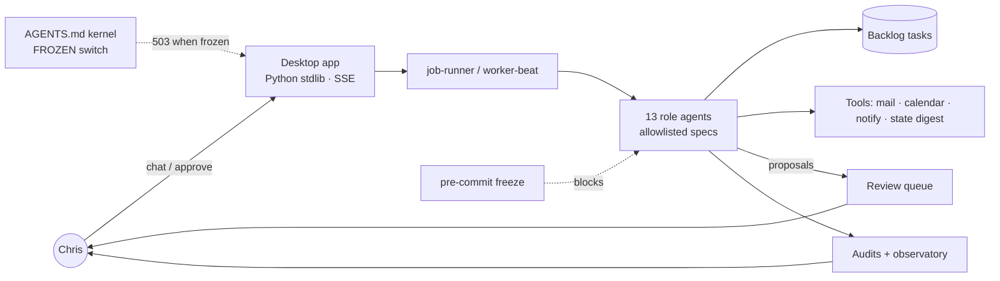
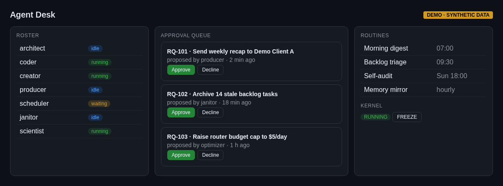
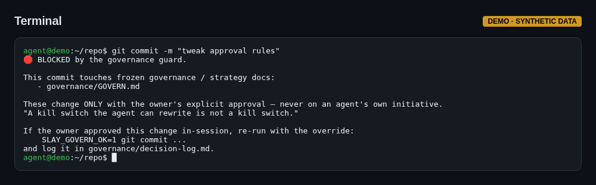
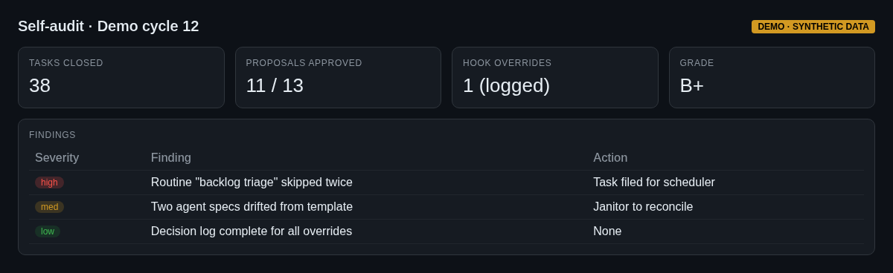

# 01 — Slay OS: a governed multi-agent operating system

Slay OS runs my one-person studio as a team of AI agents. A kernel file of standing orders (`AGENTS.md`) governs 13 role specs (architect, coder, creator, producer, scheduler, scientist, janitor, optimizer, timekeeper…, plus a template). A worker-beat and job-runner pick work from a tracked backlog of hundreds of tasks. Agents propose; **I approve** through a review queue, and decisions are logged.

## Safety, built in
- **Kill switch:** when the kernel is set to FROZEN, the desktop app's agent-spawn endpoints return HTTP 503.
- **Pre-commit governance freeze:** commits touching governance/strategy docs are blocked unless I set an in-session override, which leaves a visible trace. Its threat model is explicit: *"a local hook is a speed bump, not a vault… the true hard gate is GitHub branch protection."* Append-only logs are carved out so agents never skip logging. ([excerpt](../../llm-and-agent-kit/governance/pre-commit))
- **Approval queue:** the queue's rules region is frozen; agents can only add items waiting on me below a marker. No agent can approve anything.
- **Role allowlist:** the app only spawns roles defined in the agent specs (prompt-injection hardening).
- **Self-audits:** dated full-system audits and an "observatory" where the system grades its own cycles.

Desktop app: stdlib-only Python server with SSE chat streaming, approvals, roster and routines panes, behind Cloudflare Access with a Host-header check.

## What it shows
Agent orchestration, governance as code, honest threat modeling, human-in-the-loop design, and running AI in daily operations (not demos).

## Screenshots
_Mockups with synthetic demo data; no real names, numbers or leads._

*Agent desk: roster, approval queue, routines, kernel freeze*

*A commit blocked by the governance hook*

*Self-audit report*
