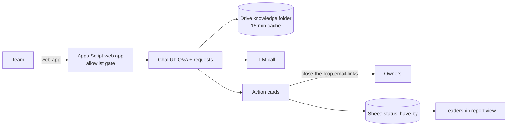
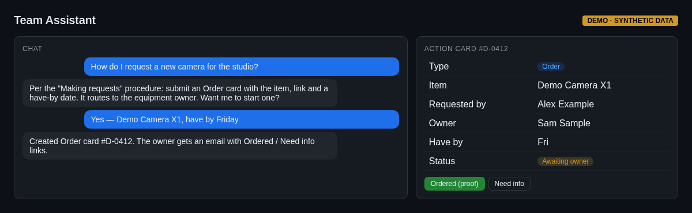
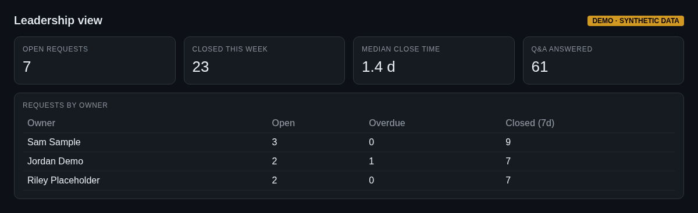

# 02 — Team assistant on Google Workspace (internal tool, in production)

An internal team app I built on **Google Apps Script plus an LLM** for a team at my current employer. It was live about two days after I started building it, and I've kept iterating on it in production from team feedback.

## What it does
- **Requests routed to owners** via action cards (e.g. order / do / project), with email links that close the loop and a status + "have by" date tracked in a Sheet
- **Q&A over the team's procedures**: retrieval from a Drive knowledge folder with a 15-minute cache
- **Automated metrics** and a separate **leadership report view**, gated by an allowlist
- Calendar events and Gmail drafts created from requests

## What it shows
Shipping an internal tool fast inside Google Workspace, LLM + retrieval over company docs, workflow state machines, and access control.

> The source is employer property and stays private. Nothing here shows real data.

## Screenshots
_Mockups with synthetic demo data; no real names, numbers or leads._

*Q&A and an Order action card*

*Leadership view*
