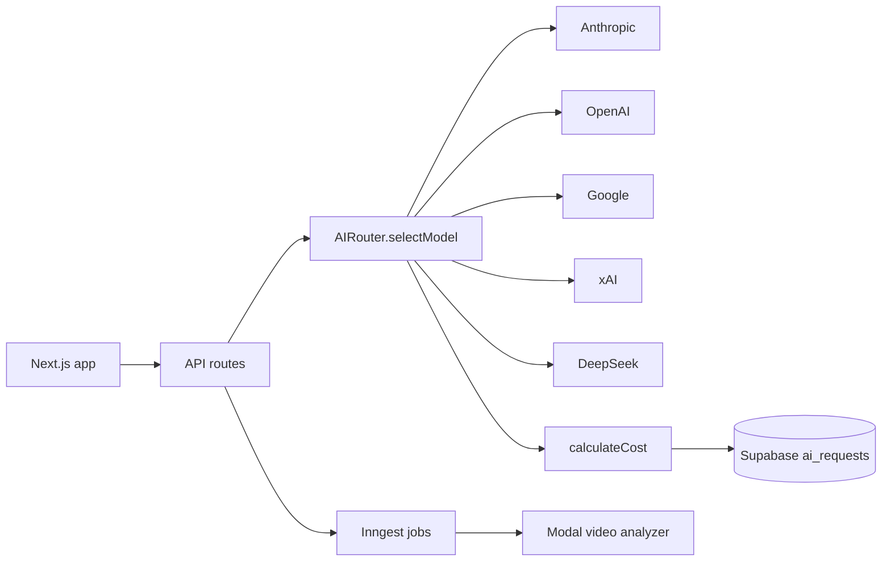
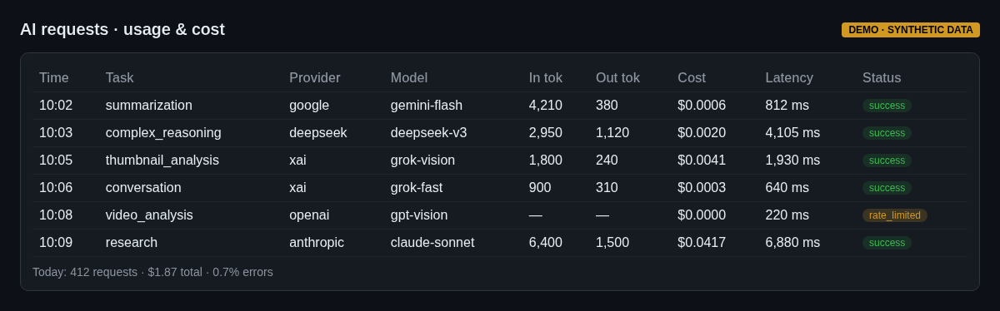
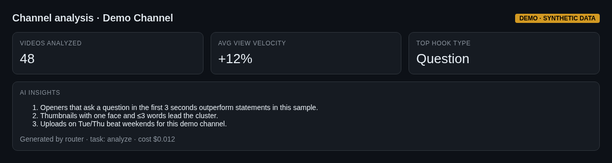

# 03 — Multi-provider LLM router with cost tracking (Immortal Creator)

Immortal Creator is a Next.js + Supabase creator-analytics app. Its AI layer (`AIRouter`) picks a model per request, calls the provider, computes cost from token usage, and logs every call — successes, errors and rate-limits — to a Supabase `ai_requests` table.

- **5 providers:** Anthropic, OpenAI, Google, xAI, DeepSeek (one adapter each behind a common interface)
- **Selection rules:** explicit provider preference → budget priority (route to the cheapest effective model per task type) → multimodal needs → long context → per-task default
- **Streaming** with cost computed when the stream completes
- **Tracking never breaks the request:** logging failures are caught and logged
- Background pipelines on Inngest, video analysis on Modal, unit tests for rate limiting and schemas

## What it shows
TypeScript, API integration across vendors, cost-aware AI design, SQL-backed usage analytics. ([excerpt](../../llm-and-agent-kit/router/router.ts))

## Screenshots
_Mockups with synthetic demo data; no real names, numbers or leads._

*Per-call usage and cost log*

*Analysis report*
