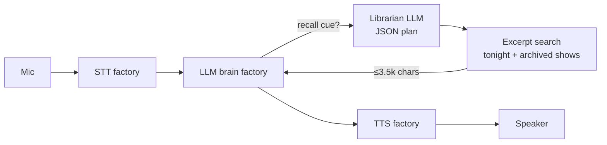
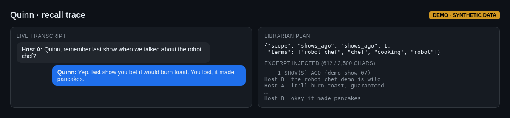
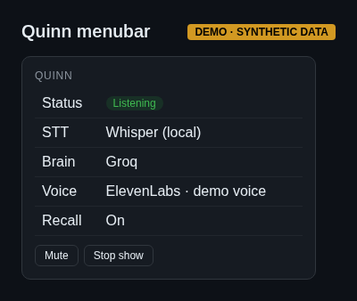

# 04 — Quinn: a live voice AI producer with LLM-planned recall

Quinn is a real-time voice co-host/producer for live shows, packaged as a macOS menubar app.

- **Speech-to-text:** Groq Whisper or local Whisper (factory pattern)
- **Swappable LLM "brain":** Groq, Gemini or Ollama
- **Text-to-speech:** ElevenLabs or macOS `say`
- **Swift menubar app** to run it

## Recall
When a host says something like "remember last show…", a tiny, fast "librarian" LLM call returns a JSON search plan — `{scope, shows_ago, terms}` — then a keyword excerpt search runs over tonight's transcript and/or archived shows. Matching lines plus context are injected, capped at 3,500 characters. Design note from the code: *"2k relevant chars beat 24k recent ones."* No vector database — cheap, transparent retrieval that fits the job. ([excerpt](../../llm-and-agent-kit/recall/recall.py))

## What it shows
Real-time pipelines, provider abstraction, retrieval design that trades complexity for cost and latency.

## Screenshots
_Mockups with synthetic demo data; no real names, numbers or leads._

*Recall trace: librarian plan and injected excerpt*

*Menubar app*
