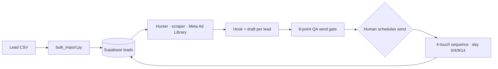
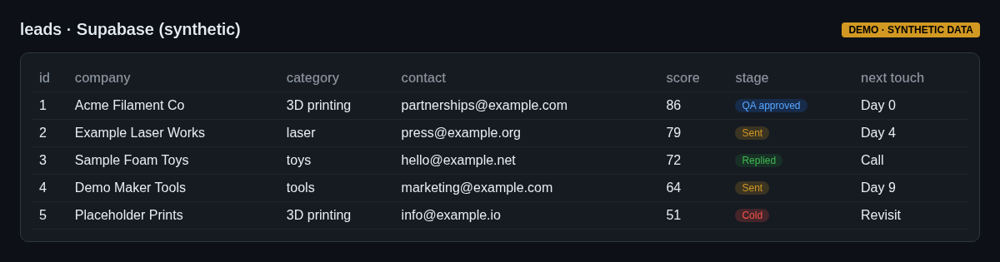

# 05 — HookLab lead pipeline (Supabase + Claude)

HookLab is my agency's sales pipeline, modeled on Clay. What's in the code today:

- **Bulk import** of a lead CSV into Supabase (`schema.sql`, `bulk_import.py`)
- **Client wrappers** for Claude, Supabase, Hunter (email lookup), the Meta Ad Library, and a web scraper
- **Human approval gate** by design: drafts are prepared, a person approves and sends

It backs a CRM of roughly 970 scored leads.

## The outreach system around it
The scoring and drafting run as a documented operating process rather than committed scripts (`projects/hooklab/sales/outreach-daily-system.md`, `projects/outreach-engine/engine/qa-send-gate.md`):
- **Daily block:** pull 5–10 leads from the scored list, write one specific hook per lead, send a small mail-merge batch, then work follow-ups
- **4-touch sequence:** day 0 opener, day 4 insight, day 9 offer, day 14 close-the-loop
- **Domain warm-up rules:** start at about 5 sends a day and ramp only while bounces stay low
- **Contact selection order:** partnerships/marketing desk first, then press, social, general, support as last resort; never spray one company's inboxes
- **8-point QA send gate** every draft passes before a human sees it: real personalization, every claim true, matching register, one ask, platform-safe pacing, no re-sends, on-voice
- **Human on the send:** an agent prepares fully addressed drafts; a person opens each one and schedules the send

## What it shows
Python API integrations, a Postgres schema, and keeping a human in the loop on outbound messages.

## Screenshots
_Mockups with synthetic demo data; no real names, numbers or leads._

*Lead table*
