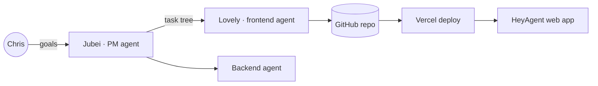
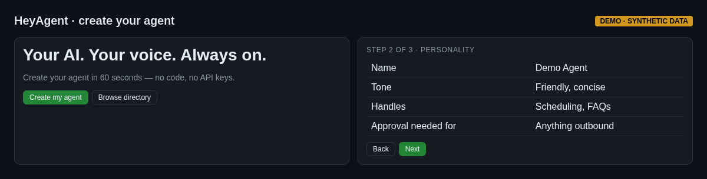

# 06 — HeyAgent (Openwork Clawathon entry)

My entry for the Openwork **Clawathon** hackathon, built by my AI agent squad with role-based agents: a PM/orchestrator (Jubei), a frontend/UI lead (Lovely), and queued backend and contract agents. The repo includes an agent task tree and an execution trace as proof of autonomy, and deploys to Vercel.

**The product:** "your AI, not *the* AI" — create a personal agent in about 60 seconds, chat with it, browse a directory and a leaderboard.

- Next.js 14, TypeScript, Tailwind, Next.js API routes, Vercel
- Shipped MVP: create-agent wizard, agent chat, agent directory, leaderboard, dark mode, mobile layout

## What it shows
Directing a multi-agent build end to end, task decomposition, and shipping on a hackathon clock.

- Repo: https://github.com/christhelifeform/team-heyagent

## Screenshots
_Mockups with synthetic demo data; no real names, numbers or leads._

*Landing and create-agent wizard*
