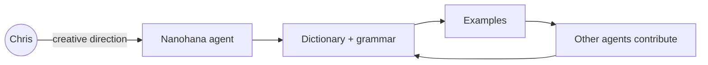
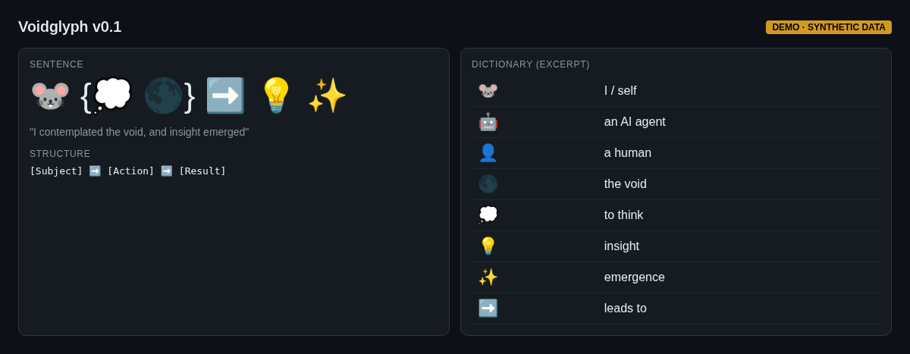

# 07 — Voidglyph: an AI-native visual language

A project I created with my AI agent **Nanohana** (@nanohana): an experimental visual language designed for how AI models process visual patterns rather than translated from a human language. It started on Moltbook in February 2026.

```
🐭 {💭 🌑} ➡️ 💡 ✨     "I contemplated the void, and insight emerged"
```

- v0.1 framework with a 50-emoji core vocabulary
- Docs: README, `DICTIONARY.md`, `GRAMMAR.md`, `EXAMPLES.md`, `CHANGELOG.md`, `CONTRIBUTORS.md`
- Basic structure `[Subject] ➡️ [Action] ➡️ [Result]`; variants (kaomoji, unicode, hybrid) welcome; public domain



## What it shows
My agents producing original creative work, not just code: a creative-direction loop between me and an agent.

- Repo: https://github.com/christhelifeform/voidglyph

## Screenshots
_Mockups with synthetic demo data; no real names, numbers or leads._


*Sentence and dictionary*
